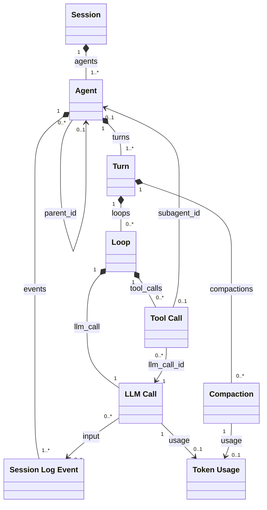
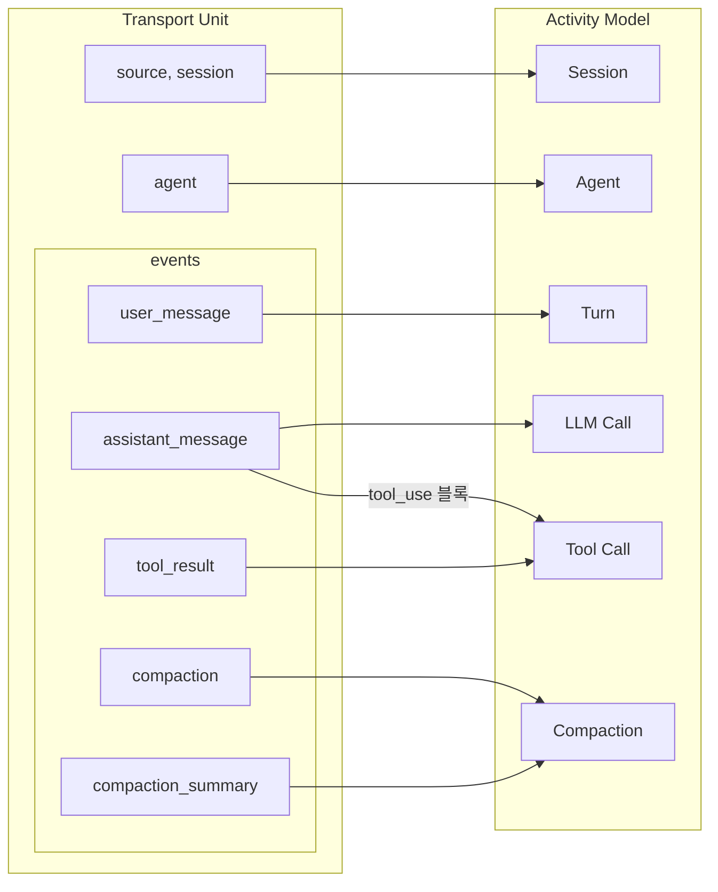

# 001.OVERVIEW.md

이 디렉터리의 문서는 애플리케이션의 도메인 모델과 각 모델이 가진 필드를 정의합니다. 이 문서는 도메인 모델의 전체 구성을 설명합니다. 용어의 의미는 [Glossary](../002.GLOSSARY.md)를 따릅니다.

도메인 모델은 두 가지로 나뉩니다.

- **[Session Log Event](002.SESSION_LOG_EVENT.md)**: Plugin이 Session Log의 레코드로 만드는 이벤트입니다. Client Adapter Daemon과 Main Server가 같은 모델을 쓰며, Main Server는 받은 그대로 저장합니다.
- **Activity Model**: Main Server의 Core가 같은 Agent의 Session Log Event 순서와 연결 관계로 구성하는 모델입니다. [Session](004.SESSION.md), [Agent](005.AGENT.md), [Turn](006.TURN.md), [Loop](007.LOOP.md), [LLM Call](008.LLM_CALL.md), [Tool Call](009.TOOL_CALL.md), [Compaction](010.COMPACTION.md)이 있습니다. Subagent는 부모 Agent가 있는 Agent입니다. Session Log Event는 이 모델들을 직접 나타내지 않습니다.

[Token Usage](003.TOKEN_USAGE.md)는 LLM Call, Compaction과 Activity Model의 합계에서 쓰는 값입니다.

## 모델 간 관계

아래 그림에서 마름모는 모델이 다른 모델을 필드로 포함하는 관계이고, 화살표는 다른 모델을 가리키는 관계입니다. 선의 이름은 그 관계를 나타내는 필드입니다. Session, Agent, Turn의 `usage`는 계산 값이므로 그리지 않았습니다.

Activity Model은 다음과 같이 Transport Unit의 값으로 만듭니다. `turn_interrupted`는 Activity Model을 만들지 않고 Turn의 끝과 `status`를 정합니다. `context_message`도 Activity Model을 만들지 않고 LLM Call의 `input`에만 나타납니다.

Loop는 만드는 Session Log Event가 따로 없으며, LLM Call 하나와 그 LLM Call이 요청한 Tool Call을 묶습니다.

## Activity Model

Activity Model의 id는 그 모델을 만든 Session Log Event의 값을 씁니다. 그래서 같은 Session Log Event를 다시 받아도 같은 Activity Model이 만들어지며, Activity Model에서 원래의 Session Log Event를 찾아갈 수 있습니다.

Activity Model의 필드 가운데 "계산 값"은 저장하지 않고 다른 필드로 계산할 수 있는 값입니다.

## 결정되지 않은 사항

각 모델의 결정되지 않은 사항은 그 모델의 문서에 있습니다. 어느 모델에 속할지 정해지지 않은 사항은 다음과 같습니다.

- Transport Unit의 `source.plugin_version`을 도메인 모델에 남길지
