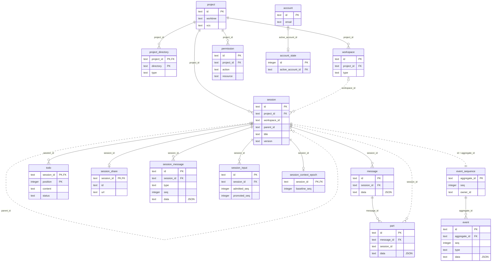

# 002.OPENCODE_DATA_ARCHITECTURE.md

이 문서는 OpenCode가 SQLite DB에 기록하는 데이터의 구조를 ERD로 정리합니다. 테이블 목록, 테이블 사이의 관계, 테이블별 열, JSON 열의 내용을 다룹니다. DB 파일의 위치는 [OpenCode Plugin](../002.implementation/006.plugin/003.opencode/001.OVERVIEW.md#위치)을, DB 옆의 `-wal`, `-shm` 파일은 [OpenCode WAL과 SHM](001.OPENCODE_WAL_AND_SHM.md)을 참고하세요.

## 확인한 범위

- 스키마: OpenCode 1.19.5가 Linux에서 만든 DB의 `sqlite_master`와 `PRAGMA foreign_key_list`에서 확인했습니다. 이 DB에는 마이그레이션 38개(`migration` 테이블, 마지막은 `20260622202450_simplify_session_input`)가 적용되어 있습니다.
- 열의 의미와 JSON 열의 타입: OpenCode v1.19.5 소스의 Drizzle 테이블 정의(`packages/core/src/**/sql.ts`)와 `packages/core/src/session/projector.ts`에서 확인했습니다.
- 행의 내용: 같은 DB의 행(session 5개, message 20개, part 71개, event 231개)에서 확인했습니다. 계정, 인증 정보, 공유, 권한, 할 일 테이블은 비어 있어 소스로만 확인했습니다.

## 테이블 분류

| 분류 | 테이블 | 설명 |
|---|---|---|
| 이벤트 로그 | `event`, `event_sequence` | session에서 일어난 일을 순서대로 쌓는 append-only 로그입니다. |
| Session Log(v1) | `session`, `message`, `part` | 이벤트를 투영(projection)한 현재 상태입니다. 행을 제자리에서 갱신합니다. |
| Session Log(v2) | `session_message`, `session_input`, `session_context_epoch` | v2 session 이벤트를 투영하는 테이블입니다. 1.19.5가 기록한 DB에서는 비어 있습니다. |
| Session 부가 정보 | `todo`, `session_share` | session의 할 일 목록과 공유 정보입니다. |
| Project | `project`, `project_directory`, `workspace`, `permission` | 작업 디렉터리(project)와 그에 딸린 정보입니다. |
| 계정 | `account`, `account_state`, `control_account`, `credential` | 로그인한 계정과 provider 인증 정보입니다. `control_account`는 소스에 `LEGACY`로 표시되어 있습니다. |
| 관리 | `migration`, `data_migration` | 적용한 스키마 마이그레이션과 데이터 마이그레이션의 목록입니다. |

## ERD

실선은 DB에 외래 키로 선언된 관계이고, 점선은 외래 키 없이 값으로만 이어지는 관계입니다. 외래 키는 모두 `ON DELETE CASCADE`이며, `account_state.active_account_id`만 `ON DELETE SET NULL`입니다. OpenCode는 `PRAGMA foreign_keys = ON`으로 DB를 엽니다.

열은 관계를 이해하는 데 필요한 것만 적었습니다. 전체 열은 [테이블별 열](#테이블별-열)을 참고하세요.

`control_account`, `credential`, `migration`, `data_migration`은 다른 테이블과 관계가 없어 그림에서 뺐습니다.

### 외래 키가 없는 관계

| 관계 | 설명 |
|---|---|
| `session.parent_id` → `session.id` | Subagent를 띄울 때 만든 child session이 자신을 띄운 session의 id를 기록합니다. 최상위 session은 `NULL`입니다. `session_parent_idx` 인덱스가 있습니다. |
| `session.workspace_id` → `workspace.id` | session이 속한 workspace입니다. 없으면 `NULL`입니다. |
| `part.session_id` → `session.id` | `part`가 속한 message의 `session_id`와 같은 값입니다. message를 거치지 않고 session의 part를 찾기 위해 둡니다. |
| `event_sequence.aggregate_id` = `session.id` | 이벤트의 aggregate는 session입니다. 확인한 DB에서 `aggregate_id` 5개가 모두 `session.id`였습니다. 외래 키로 이어져 있지 않아 cascade로 지워지지는 않지만, OpenCode는 session을 삭제할 때 그 session의 `event_sequence`와 `event` 행을 한 트랜잭션으로 직접 지웁니다(소스의 `Session.remove`). |
| `message.data.parentID` → `message.id` | assistant message가 자신이 답한 user message의 id를 기록합니다. JSON 안의 값입니다. |

## 식별자

| 대상 | 형식 | 예 |
|---|---|---|
| session | `ses_` + 26자 | `ses_e2cbc37bfffeKstRuPuOod51US` |
| message | `msg_` + 26자 | `msg_182ba1e520018Rse48nkEOUY68` |
| part | `prt_` + 26자 | `prt_182ba1e56001arhEiiC5EFoUrR` |
| event | `evt_` + 26자 | `evt_182ba1e2e001g4c2rRgICMiDzI` |
| project | git 저장소의 최초 커밋 해시(`git rev-list --max-parents=0 HEAD`). git 저장소가 아니면 `global` | `194de170247a16742a08fb537f5106c234cd040a` |

message, part, event의 id는 접두사 뒤에 시각이 들어 있어 사전순 정렬이 생성 순서와 거의 같습니다. 시각은 모두 Unix epoch 밀리초 정수입니다.

## 테이블별 열

`time_created`, `time_updated`는 여러 테이블에 공통으로 있는 `NOT NULL` 정수 열이며 아래 표에서는 생략합니다. 타입 뒤의 `?`는 `NULL`을 허용한다는 뜻입니다.

### 이벤트 로그

#### `event`

| 열 | 타입 | 설명 |
|---|---|---|
| `id` | text PK | 이벤트 id |
| `aggregate_id` | text FK | 이벤트가 속한 aggregate(session)의 id. `event_sequence.aggregate_id` 참조 |
| `seq` | integer | aggregate 안의 순번 |
| `type` | text | 버전이 붙은 이벤트 종류(예: `message.part.updated.1`) |
| `data` | text(JSON) | 이벤트 내용 |

인덱스: `event_aggregate_seq_idx`(`aggregate_id`, `seq`) UNIQUE, `event_aggregate_type_seq_idx`(`aggregate_id`, `type`, `seq`)

확인한 DB에 기록된 이벤트 종류와 `data`의 키는 다음과 같습니다.

| `type` | `data`의 키 |
|---|---|
| `session.created.1` | `sessionID`, `info`(session 정보) |
| `session.updated.1` | `sessionID`, `info` |
| `message.updated.1` | `sessionID`, `info`(message 정보) |
| `message.part.updated.1` | `sessionID`, `part`(part 정보), `time` |

소스의 projector는 이 밖에 `session.deleted`, `message.removed`, `message.part.removed`와 v2 session 이벤트(step, text, tool, reasoning, compaction 등)도 투영합니다.

#### `event_sequence`

| 열 | 타입 | 설명 |
|---|---|---|
| `aggregate_id` | text PK | aggregate(session)의 id |
| `seq` | integer | 그 aggregate에 마지막으로 기록한 이벤트의 `seq` |
| `owner_id` | text? | 이 aggregate에 이벤트를 기록하는 주체의 id. 확인한 DB에서는 모두 `NULL`입니다. |

이벤트를 기록할 때 `event_sequence`의 `seq`를 올리고 `event` 행을 추가하며, 투영 테이블(`session`, `message`, `part` 등) 쓰기와 같은 트랜잭션에서 커밋합니다.

### Session Log(v1)

#### `session`

| 열 | 타입 | 설명 |
|---|---|---|
| `id` | text PK | session id |
| `project_id` | text FK | `project.id` 참조 |
| `workspace_id` | text? | `workspace.id`(외래 키 없음) |
| `parent_id` | text? | 부모 session의 id(외래 키 없음) |
| `slug` | text | 사람이 읽는 짧은 이름(예: `misty-tiger`) |
| `directory` | text | 작업 디렉터리 |
| `path` | text? | 경로 |
| `title` | text | 제목 |
| `version` | text | session을 만든 OpenCode 버전(예: `1.19.5`) |
| `share_url` | text? | 공유 URL |
| `summary_additions`, `summary_deletions`, `summary_files` | integer? | 변경 요약(추가 줄, 삭제 줄, 파일 수) |
| `summary_diffs` | text(JSON)? | 파일별 diff |
| `metadata` | text(JSON)? | 임의의 메타데이터 |
| `cost` | real | 누적 비용 |
| `tokens_input`, `tokens_output`, `tokens_reasoning`, `tokens_cache_read`, `tokens_cache_write` | integer | 누적 토큰 수. `step-finish` part의 값을 더합니다. |
| `revert` | text(JSON)? | 되돌리기 상태 |
| `permission` | text(JSON)? | session의 권한 규칙 |
| `agent` | text? | 사용 중인 agent 이름(예: `build`) |
| `model` | text(JSON)? | `{ id, providerID, variant? }` |
| `time_compacting` | integer? | compaction을 시작한 시각 |
| `time_archived` | integer? | 보관한 시각 |

인덱스: `session_project_idx`, `session_workspace_idx`, `session_parent_idx`

#### `message`

| 열 | 타입 | 설명 |
|---|---|---|
| `id` | text PK | message id |
| `session_id` | text FK | `session.id` 참조 |
| `data` | text(JSON) | message 정보에서 `id`, `sessionID`를 뺀 것 |

인덱스: `message_session_time_created_id_idx`(`session_id`, `time_created`, `id`)

`data`의 키는 `role`에 따라 다릅니다.

| `role` | 키 |
|---|---|
| `user` | `role`, `time`, `agent`, `model`, `summary`? |
| `assistant` | `role`, `time`, `parentID`, `agent`, `mode`, `providerID`, `modelID`, `variant`?, `path`, `cost`, `tokens`, `finish` |

#### `part`

| 열 | 타입 | 설명 |
|---|---|---|
| `id` | text PK | part id |
| `message_id` | text FK | `message.id` 참조 |
| `session_id` | text | session id(외래 키 없음) |
| `data` | text(JSON) | part 정보에서 `id`, `sessionID`, `messageID`를 뺀 것 |

인덱스: `part_message_id_id_idx`(`message_id`, `id`), `part_session_idx`(`session_id`)

`data.type`에 따라 키가 다릅니다. 확인한 DB에 있던 종류는 다음과 같습니다.

| `type` | 키 |
|---|---|
| `text` | `text`, `time`?, `metadata`? |
| `reasoning` | `text`, `time`, `metadata`? |
| `tool` | `tool`, `callID`, `state`(`status`, 입력, 출력 등), `metadata`? |
| `step-start` | `snapshot`? |
| `step-finish` | `reason`, `cost`, `tokens`, `snapshot`? |

### Session Log(v2)

v2 session 이벤트에서 투영하는 테이블입니다. 1.19.5가 기록한 확인한 DB에서는 세 테이블 모두 행이 없었습니다.

| 테이블 | 주요 열 | 설명 |
|---|---|---|
| `session_message` | `id` PK, `session_id` FK, `type`, `seq`, `data`(JSON) | session의 message. `type`은 `assistant`, `shell` 등이며 `(session_id, seq)`가 UNIQUE입니다. |
| `session_input` | `id` PK, `session_id` FK, `prompt`(JSON), `delivery`, `admitted_seq`, `promoted_seq`? | 사용자 입력 대기열. 받아들인 순번(`admitted_seq`)과 message로 올린 순번(`promoted_seq`)을 기록합니다. |
| `session_context_epoch` | `session_id` PK FK, `baseline`, `snapshot`(JSON), `baseline_seq` | session의 system context snapshot과 그 기준 순번 |

### Session 부가 정보

| 테이블 | 주요 열 | 설명 |
|---|---|---|
| `todo` | (`session_id`, `position`) PK, `content`, `status`, `priority` | session의 할 일 목록 |
| `session_share` | `session_id` PK FK, `id`, `secret`, `url` | session 공유 정보 |

### Project

| 테이블 | 주요 열 | 설명 |
|---|---|---|
| `project` | `id` PK, `worktree`, `vcs`?, `name`?, `icon_url`?, `icon_url_override`?, `icon_color`?, `time_initialized`?, `sandboxes`(JSON 배열), `commands`(JSON)? | project. `sandboxes`는 같은 저장소의 다른 작업 디렉터리(git worktree 등) 목록입니다. |
| `project_directory` | (`project_id`, `directory`) PK, `type`?(`main`, `root`, `git_worktree`), `strategy`? | project에 속한 디렉터리 |
| `workspace` | `id` PK, `project_id` FK, `type`, `name`, `branch`?, `directory`?, `extra`(JSON)?, `time_used` | project 안의 workspace |
| `permission` | `id` PK, `project_id` FK, `action`, `resource` | project에 저장한 권한 결정. `(project_id, action, resource)`가 UNIQUE입니다. |

### 계정

| 테이블 | 주요 열 | 설명 |
|---|---|---|
| `account` | `id` PK, `email`, `url`, `access_token`, `refresh_token`, `token_expiry`? | 로그인한 계정 |
| `account_state` | `id` PK, `active_account_id`? FK, `active_org_id`? | 현재 쓰는 계정과 조직 |
| `control_account` | (`email`, `url`) PK, `access_token`, `refresh_token`, `token_expiry`?, `active` | 이전 방식의 계정 정보(LEGACY) |
| `credential` | `id` PK, `integration_id`?, `label`, `value`(JSON), `connector_id`?, `method_id`?, `active`? | provider 등의 인증 정보 |

`account`, `control_account`, `credential`에는 토큰과 인증 정보가 평문으로 들어 있습니다.

### 관리

| 테이블 | 주요 열 | 설명 |
|---|---|---|
| `migration` | `id` PK, `time_completed` | 적용한 스키마 마이그레이션 |
| `data_migration` | `name` PK, `time_completed` | 완료한 데이터 마이그레이션 |
